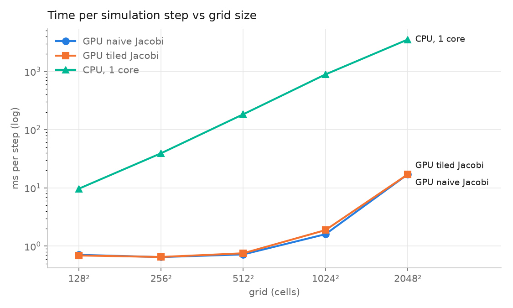
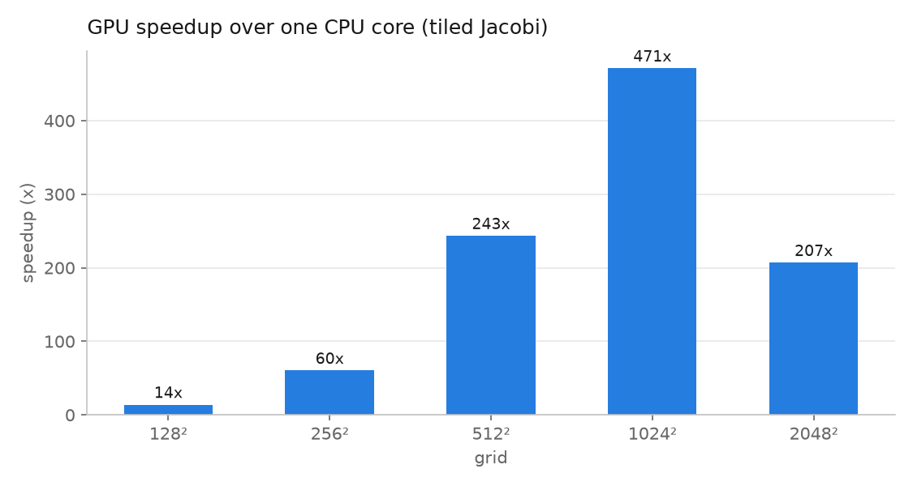
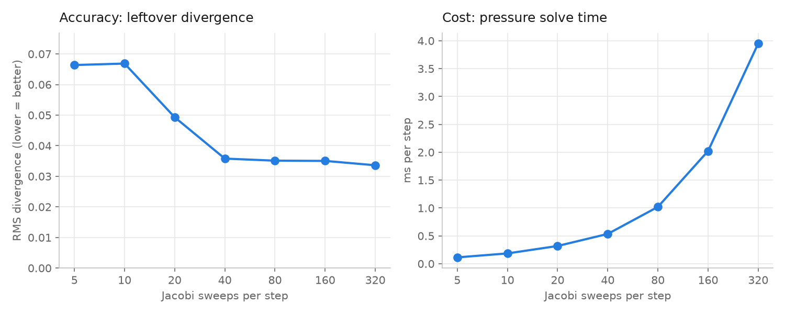
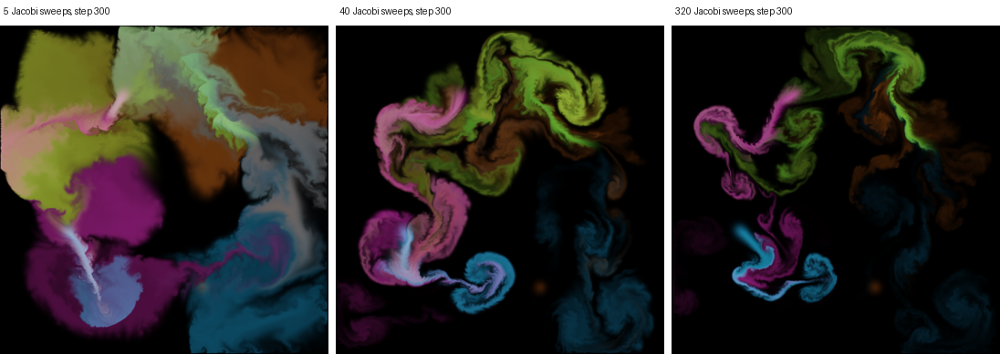
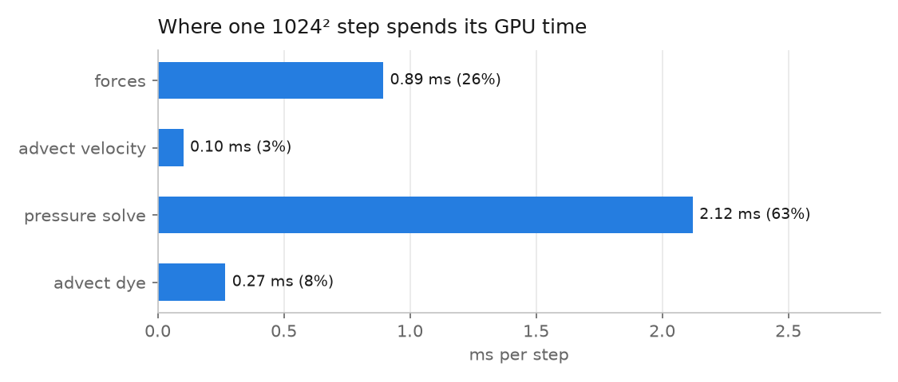
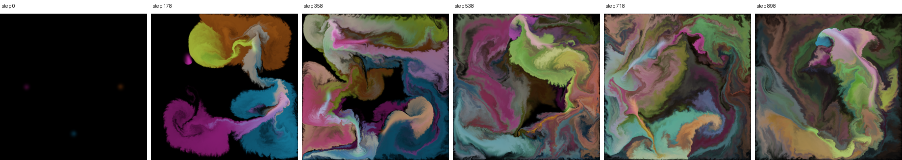

# GPU Fluid Simulation with Runtime-Compiled CUDA Kernels

A 2-D smoke/dye simulation (Jos Stam's *Stable Fluids*) where every step of the
physics runs in **CUDA kernels I wrote myself**. The kernels are compiled at
runtime with **NVRTC** and launched through the **CUDA driver API**. A
single-threaded CPU version of the same solver is included, to check the GPU
results and measure the speedup.


*1024×1024 grid, 900 steps, four pulsing dye jets on a rotating ring
([full-quality MP4](output/demo/fluid.mp4)).*

| | |
|---|---|
| Demo run | 1024² cells, 900 steps, 450 frames, **3.4 ms per step**, 18.7 s wall time |
| Speedup vs one CPU core | **471×** at 1024², 243× at 512², 207× at 2048² (see below for why it drops) |
| GPU vs CPU agreement | max velocity difference 8.1e-5 (max \|v\| ≈ 5.7) after 3 steps at 1024² |
| Kernels | 10 custom kernels, NVRTC → sm_89 cubin (34 KB) in ~60 ms at startup |
| Hardware | RTX 4050 Laptop GPU (sm_89, 20 SMs, 24 MB L2), driver CUDA 13.1, NVRTC 12.9 |

## Why this project

In the previous course project I used NPP, where NVIDIA wrote the kernels. For the
capstone I wanted to write the kernels myself, on a problem where the GPU is
actually needed. A fluid solver is a good fit:
- Every cell does the same work every step.
- The pressure solve needs dozens of passes over the whole grid per frame.
- A real-time result is something you can see.

I also wanted to measure *why* the GPU is fast or slow at each size, instead of
only reporting one speedup number.

## How one simulation step works

Every field (velocity x/y, pressure, divergence, curl, dye R/G/B) is an n×n
`float` array. Each kernel runs on 16×16 thread blocks covering the grid, one
thread per cell. Fields that are read and written in the same pass use
ping-pong buffers.

| # | Phase | Kernel(s) in [`src/kernels/fluid.cu`](src/kernels/fluid.cu) | What it does |
|---|---|---|---|
| 1 | forces | `ApplyEmitters` | 4 gaussian jets add velocity and dye. The whole emitter set is passed **by value** as one struct kernel parameter. |
| | | `Curl`, `Vorticity` | vorticity confinement: puts back the small swirls that numerical diffusion removes |
| 2 | advect velocity | `Advect` ×2 | semi-Lagrangian: trace each cell backwards along v and take a bilinear sample there |
| 3 | projection | `Divergence` | ∇·v |
| | | `JacobiTiled` / `JacobiNaive` ×40 | Jacobi sweeps of the pressure Poisson equation ∇²p = ∇·v, warm-started from the previous step |
| | | `SubtractGradient`, `SetBoundary` | v ← v − ∇p makes the flow (almost) incompressible; walls are solid |
| 4 | advect dye | `Advect` ×3 | dye is carried by the projected velocity |
| | output | `Render` | dye → 8-bit RGB with an exposure curve, only on frames that get saved |

`JacobiTiled` loads the block's 16×16 tile plus a 1-cell halo into shared memory
once, then does the 5-point stencil from shared memory. Threads in partial edge
blocks still help load the halo, and return only after `__syncthreads()`.
`JacobiNaive` reads all 5 values from global memory. The two produce
bit-identical results.

### GPU techniques used

* **Runtime compilation with NVRTC.** `fluid.cu` is compiled at startup for the
  exact GPU (`--gpu-architecture=sm_89`). A real cubin is loaded with
  `cuModuleLoadData`, so nothing is JIT-compiled from PTX.
  * This also means the host program needs no `nvcc` at all. It builds with
    plain g++ on Linux and with MinGW g++ on Windows, where `nvcc` would need
    Visual Studio.
* **Driver API.** The program uses `cuInit`, the primary context, `cuMemAlloc`,
  and `cuLaunchKernel` with a small variadic `Launch2D` helper.
* **Per-phase GPU timing.** Five CUDA events per step time the four phases
  separately (`steps.csv`).
* **Reproducible GPU/CPU comparison.**
  * The emitter script depends only on (step, n), so both solvers get the same
    input.
  * FMA contraction is off on both sides (`--fmad=false` in NVRTC,
    `-ffp-contract=off` in g++), so they do the same float operations.
* **Overlapping CPU and GPU work.** Saving PNG frames is done by a pool of
  background threads, so the simulation loop never waits for the encoder. See
  lesson 4.

## Experiments and results

`run.sh` runs all three experiments in one go. Everything below is from
[`output/`](output).

### 1. Scaling: grid size, naive vs tiled, GPU vs CPU

300 steps per run, 40 Jacobi sweeps, no frames
([`scaling.csv`](output/scaling.csv)).

| grid | GPU naive (ms/step) | GPU tiled (ms/step) | CPU 1 core (ms/step) | speedup (tiled) |
|---|---|---|---|---|
| 128² | 0.71 | 0.69 | 9.7 | 14× |
| 256² | 0.65 | 0.65 | 39.3 | 60× |
| 512² | 0.72 | 0.75 | 183.6 | 243× |
| 1024² | **1.60** | 1.88 | 888.0 | 471× |
| 2048² | 17.06 | 17.05 | 3526.1 | 207× |




### 2. Pressure solver: accuracy vs cost

512², 300 steps, 5 to 320 Jacobi sweeps per step
([`jacobi.csv`](output/jacobi.csv)).




With 5 sweeps the projection is too weak, so the flow is no longer
incompressible: dye swells into blobs like an expanding gas. 40 sweeps give
proper curling vortices, and 320 sweeps look almost the same as 40.

### 3. Demo run

1024², 900 steps, a frame every 2 steps ([`run.log`](output/demo/run.log),
[`steps.csv`](output/demo/steps.csv), [keyframes](output/demo/keyframes)).




## Lessons learned

1. **Small grids are launch-bound, not compute-bound.** One step is 51 kernel
   launches (40 of them Jacobi), and from 128² to 512² the time per step stays
   at about 0.7 ms, roughly 13 µs per launch. Making the kernels faster would
   not help there. Fewer launches would: CUDA Graphs, or several Jacobi
   sweeps fused into one kernel.
2. **There is a cache cliff between 1024² and 2048².** 4× more cells costs
   **10×** more time (pressure solve 0.85 → 12.3 ms). Each Jacobi sweep touches
   three fields. At 1024² that is 3 × 4 MB = 12 MB, which fits in the 24 MB L2
   cache, so all 40 sweeps run out of cache. At 2048² it is 48 MB and every
   sweep goes to DRAM. That's why the speedup drops from 471× to 207×. I did
   not expect this before plotting the data.
3. **Shared-memory tiling did not pay off here.** Tiled was the same or
   slower: 1.16 vs 0.85 ms for the pressure solve at 1024². On a modern GPU the
   L1/L2 caches already give the 5-point stencil its neighbour reuse, and the
   tile version adds a halo load and a `__syncthreads()` per sweep. Tiling is
   worth it when a block reuses data many times (e.g. matrix multiply), not
   for one 5-point read per cell.
4. **On a laptop, CPU work slows the GPU down.** Writing 1024² PNGs on the main
   thread made the GPU sit idle about 180 ms per frame. It dropped its clocks,
   and the measured step time went from 1.9 to 13.5 ms. Moving PNG encoding to
   background threads brought the demo from 161 s to 18.7 s of wall time.
   * The demo still measures 3.4 ms per step instead of 1.9, because 8 busy CPU
     encoder threads share the laptop's power budget with the GPU.
   * The same effect hid the speedup at first. Running one GPU step between
     multi-second CPU steps made the GPU look up to 8× slower than it is at
     2048² (76–144 ms instead of 17 ms). The GPU reference steps now run back
     to back.
5. **More Jacobi sweeps hit a floor.** Divergence drops quickly up to about 40
   sweeps, then barely moves: 0.036 at 40, 0.034 at 320.
   * The leftover error isn't solver error. On a collocated grid, the compact
     5-point Laplacian I solve doesn't exactly match the wide central-difference
     divergence and gradient, so even a perfect solve leaves some divergence.
   * A staggered (MAC) grid would remove that floor, and multigrid would get
     there in far fewer sweeps.
6. **GPU and CPU agree, but chaos amplifies differences.** After 3 steps the
   difference is around 1e-7 at small grids and 8.7e-4 at 2048². Even with FMA
   off, `expf`/`sqrtf` differ by an ulp between GPU and CPU, and a turbulent
   flow amplifies such differences over time. That's why the check runs only
   a few steps.

## Repository layout

```
.
|-- Makefile                    build / run / lint on Linux (no nvcc needed)
|-- run.sh                      build + all experiments + video + plots + proof tarball
|-- src/
|   |-- kernels/fluid.cu        the CUDA kernels (compiled at runtime by NVRTC)
|   |-- main.cc                 CLI entry: run, log, CPU comparison, summary
|   |-- config.h/.cc            Config struct, flag parsing and validation
|   |-- cuda_context.h/.cc      driver API + NVRTC: context, memory, module build, Launch2D, events
|   |-- fluid_gpu.h/.cc         GPU solver: buffers and kernel order of one step
|   |-- fluid_cpu.h/.cc         same solver on one CPU core (reference + speedup)
|   |-- fluid_common.h/.cc      emitter script shared by both solvers, StepTimes
|   `-- image_writer.h/.cc      PNG writing (stb) + background FrameWriter
|-- scripts/
|   |-- plot_results.py         CSVs -> charts and image sheets
|   |-- build_windows.ps1       Windows build (MinGW g++ + NVIDIA pip wheels)
|   `-- run_windows.ps1         Windows version of run.sh
|-- third_party/stb/            stb_image_write (public domain / MIT)
|-- output/                     proof of execution (logs, CSVs, plots, video)
`-- presentation/               slide deck + talk script for the video
```

## Requirements and install

**Linux (Coursera lab or any CUDA machine):**
- an NVIDIA GPU and driver;
- the CUDA toolkit (11.2 or newer) for `cuda.h`, `nvrtc.h`, `libnvrtc` and
  `libcuda`;
- g++ with C++17 and GNU make.

For the video, plots and proof tarball you also need `ffmpeg` and Python 3 with
matplotlib and Pillow (`pip install matplotlib pillow`).
`run.sh` skips the video or the plots if those tools are missing.

**Windows (how the results in `output/` were made):** you need an NVIDIA driver,
Python, MinGW-w64 g++ (MSYS2 ucrt64) and Git for Windows. No Visual Studio or
CUDA toolkit is needed. `scripts/build_windows.ps1` installs NVIDIA's
`nvidia-cuda-runtime-cu12` (for `cuda.h` and `cuda.lib`) and
`nvidia-cuda-nvrtc-cu12` (for the NVRTC DLL) wheels into `tools/`. The driver
API comes from the `nvcuda.dll` installed with the driver.

## Build and run

```bash
make                    # -> bin/gpu_fluid
./run.sh                # all experiments, video, plots, proof_of_execution.tar.gz
make demo               # quick 512x512 run with frames into output/quick
./bin/gpu_fluid --help
```

Windows:

```powershell
powershell -ExecutionPolicy Bypass -File scripts\run_windows.ps1    # build + everything
powershell -ExecutionPolicy Bypass -File scripts\build_windows.ps1  # build only
```

The program reads `src/kernels/fluid.cu` at startup, so run it from the repo
root or pass `--kernel_file`.

## Command line

| Flag | Default | Meaning |
|---|---|---|
| `--grid` | 512 | Simulation size N×N (32..4096) |
| `--steps` | 600 | Time steps |
| `--dt` | 1.0 | Time step |
| `--jacobi_iters` | 40 | Pressure sweeps per step |
| `--jacobi_kernel` | tiled | `tiled` (shared memory) or `naive` (global memory) |
| `--vorticity` | 0.3 | Vorticity confinement strength, 0 = off |
| `--velocity_dissipation` | 0.999 | Velocity kept per step |
| `--dye_dissipation` | 0.997 | Dye kept per step |
| `--force` | 1.2 | Emitter strength (scaled with grid size) |
| `--frame_every` | 0 | Save a PNG every N steps (0 = none) |
| `--log_every` | 50 | Progress line + divergence check every N steps |
| `--cpu_compare_steps` | 0 | Also run the CPU solver N steps, compare fields and speed |
| `--output_dir` | output | Where `steps.csv` and `frames/` go |
| `--summary_csv` | (none) | Append a one-line summary (used by the sweeps) |
| `--kernel_file` | src/kernels/fluid.cu | CUDA source compiled by NVRTC |
| `--device` | 0 | CUDA device id |

Bad values print the reason plus the usage text, and the program exits with
code 1. Runtime CUDA/NVRTC errors exit with code 2. Examples:

```bash
./bin/gpu_fluid --grid=2048 --steps=300 --jacobi_kernel=naive --cpu_compare_steps=3
./bin/gpu_fluid --grid=512 --jacobi_iters=5 --frame_every=10 --output_dir=out_weak
./bin/gpu_fluid --grid=768 --vorticity=0 --force=2 --frame_every=4
```

## Proof of execution

```
output/
|-- demo/run.log, demo/steps.csv     1024² run: console log, per-step phase timings
|-- demo/fluid.mp4, demo/fluid.gif   the video (450 frames)
|-- demo/keyframes/step_*.png        6 full-resolution frames
|-- scaling.csv, scaling/*.log       10 runs: 128²..2048², naive vs tiled, CPU comparison
|-- jacobi.csv, jacobi/*             7 runs: 5..320 sweeps, logs + first/last frame
`-- plots/*.png                      the charts above
```

`run.sh` also packs this folder, without the raw frames, into
`proof_of_execution.tar.gz`.

## Presentation

[`presentation/gpu_fluid_capstone.pptx`](presentation/gpu_fluid_capstone.pptx) has
12 slides, and the speaker notes hold the full talk. The same text is in
[`presentation/talk_script.md`](presentation/talk_script.md) (about 8–9 minutes,
with the demo video played on slide 5).

## Next steps

* **CUDA Graphs:** capture the 51 launches of one step once and replay them,
  to remove the launch floor on small grids.
* **Multigrid pressure solver:** converges in a handful of V-cycles, instead of
  needing 40+ Jacobi sweeps that barely reach low frequencies.
* **MAC (staggered) grid:** removes the divergence floor from lesson 5.
* **Real-time display:** OpenGL/CUDA interop, so the dye texture is drawn
  straight from device memory with no PNG round trip.
* **3-D smoke**, where the cache cliff from lesson 2 arrives much sooner.

## References

* J. Stam, "Stable Fluids", SIGGRAPH 1999.
* M. Harris, "Fast Fluid Dynamics Simulation on the GPU", *GPU Gems*, ch. 38, 2004.
* NVIDIA, *NVRTC User Guide* and *CUDA Driver API* documentation.
* [stb_image_write](https://github.com/nothings/stb) by Sean Barrett.
